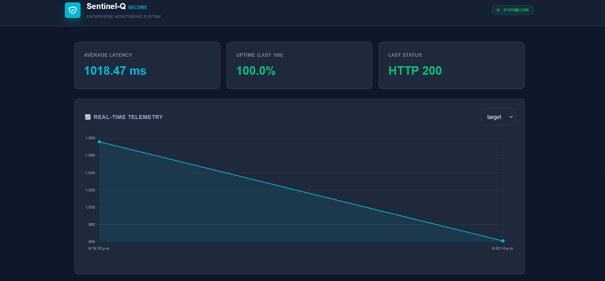
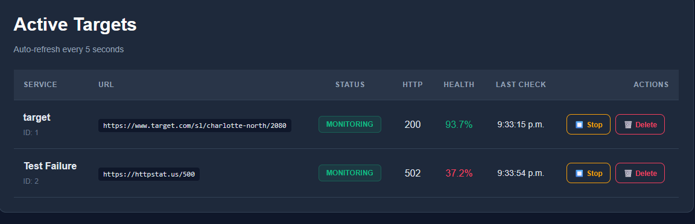

# 🛡️ Sentinel-Q

**Sentinel-Q** is a self-hosted service monitoring engine. It checks your HTTP endpoints on a schedule, scores their health, stores metrics in PostgreSQL and sends Telegram alerts when a service goes down or recovers. The API is protected with JWT.




---

## Features

- **Scheduled async checks** with APScheduler and httpx
- **Health score (0-100)** per target, combining success rate and latency stability
- **Persistent metrics and incident history** in PostgreSQL
- **Telegram alerts** with failure/recovery thresholds, a stability window and a cooldown to avoid flapping
- **JWT authentication** (HS256); the login endpoint is rate-limited to 5 requests per minute per IP
- **Input validation** (Pydantic v2): HTTP/HTTPS URLs only, check interval between 5 and 86400 seconds, restricted target names
- **Security headers** and configurable CORS
- **Persistent logs** (Loguru, daily rotation, 10-day retention)
- **Graceful shutdown** of the scheduler, the Telegram poller and the database engine
- **Docker Compose** deployment: API, Streamlit dashboard and PostgreSQL 15

**Stack:** Python 3.13, FastAPI, SQLAlchemy 2, PostgreSQL 15, APScheduler, Pydantic v2, python-jose, passlib/bcrypt, slowapi, Loguru, Docker.

---

## Quick start

```bash
git clone https://github.com/OpSigma80/Sentinel-Q.git && cd Sentinel-Q
cp .env.example .env     # edit it: database, JWT secret, admin credentials, Telegram
docker compose up -d --build
```

- API docs: http://localhost:8000/docs
- Dashboard: http://localhost:8000
- Streamlit dashboard: http://localhost:8501

### Configuration

Set these in `.env` (see `.env.example` for the full list). Use your own values, never reuse the examples.

| Variable | Purpose |
|---|---|
| `POSTGRES_USER`, `POSTGRES_PASSWORD`, `POSTGRES_DB` | PostgreSQL credentials |
| `DATABASE_URL` | SQLAlchemy connection string |
| `JWT_SECRET_KEY` | Secret used to sign tokens (long and random) |
| `JWT_ALGORITHM`, `JWT_EXPIRE_MINUTES` | Token algorithm and lifetime |
| `ADMIN_USERNAME`, `ADMIN_PASSWORD` | Credentials accepted by `POST /auth/token` |
| `BOT_TOKEN`, `CHAT_ID` | Telegram bot token and destination chat |
| `ALERT_FAILURE_THRESHOLD` | Consecutive failed checks before alerting |
| `ALERT_RECOVERY_THRESHOLD` | Consecutive successful checks before the recovery alert |
| `ALERT_COOLDOWN_SECONDS` | Cooldown for repeated flapping incidents |
| `CORS_ORIGINS` | Comma-separated allowed origins |

---

## Authentication and API

Every endpoint except `/` (dashboard), `/static` and `POST /auth/token` requires a Bearer token.

| Method | Path | Description |
|---|---|---|
| `POST` | `/auth/token` | Log in (form fields `username`, `password`) and get a JWT |
| `GET` | `/targets` | List targets with their health |
| `POST` | `/targets` | Create a target (201) |
| `DELETE` | `/targets/{id}` | Delete a target (204) |
| `DELETE` | `/stop/{id}` | Stop monitoring and delete a target (204) |
| `GET` | `/status` | Status of active targets |
| `GET` | `/metrics/{id}` | Metrics of one target |
| `GET` | `/stats/{id}` | Statistics and health score of one target |
| `GET` | `/health` | System health (database, scheduler, active targets) |
| `GET` | `/telegram/status` | Status snapshot used by the Telegram bot |
| `GET` | `/telegram/metrics` | Metrics snapshot used by the Telegram bot |
| `GET` | `/telegram/alerts?hours=24` | Alert history |

```bash
# 1. Get a token
TOKEN=$(curl -s -X POST http://localhost:8000/auth/token \
  -d "username=$ADMIN_USERNAME&password=$ADMIN_PASSWORD" \
  | python3 -c "import sys,json; print(json.load(sys.stdin)['access_token'])")

# 2. Create a target
curl -X POST http://localhost:8000/targets \
  -H "Authorization: Bearer $TOKEN" -H "Content-Type: application/json" \
  -d '{"name": "My API", "url": "https://api.example.com/health", "check_interval": 60, "is_active": true}'

# 3. List targets
curl http://localhost:8000/targets -H "Authorization: Bearer $TOKEN"
```

**Status codes:** `401` without a token, `403` with an invalid or expired token, `422` for invalid input, `429` after 5 login attempts per minute from the same IP.

---

## Architecture

```
Client / Dashboard ──► FastAPI (JWT, rate limit) ──► Services ──► Repository ──► PostgreSQL
                              │
      APScheduler ──► httpx checks ──► metrics + incidents
                              │
                Telegram notifier / bot poller
```

```
src/sentinel/
├── application/     scheduler, notifier, telegram poller, checker
├── domain/          models and schemas
├── infrastructure/  database, repository, auth, jwt_service, rate_limiter
└── services/        target, monitoring, analytics and health services
```

---

## Testing

```bash
python3 -m venv venv && source venv/bin/activate
pip install -r requirements-dev.txt
pytest -q
```

177 tests covering JWT authentication, rate limiting, the repository and service layers, health scoring, alerting, the Telegram bot and input validation. They run against in-memory SQLite and need no `.env`; background tasks are disabled when `TESTING=1` (set by `tests/conftest.py`).

---

## Known limitations

- All API endpoints require a JWT, including `/health`, so there is no unauthenticated probe for Kubernetes or Docker health checks yet.
- Rate limiting is applied to the login endpoint only.
- A single admin account is configured through environment variables.
- TLS is not built in: terminate HTTPS in a reverse proxy.
- The bundled web dashboard does not send the JWT yet, so it cannot read or create targets until login support is added.

## Roadmap

- [ ] Multi-tenancy: tenants, per-tenant users and scoped targets (designed, with tests in `tests/pending/`; implementation being rebuilt)
- [ ] Outbound webhooks for down/up events (same status)
- [ ] Public liveness endpoint
- [ ] Rate limits on protected endpoints
- [ ] Slack notifications
- [ ] Anomaly detection and OpenTelemetry tracing

---

## Contributing

1. Fork the repository and create a branch: `git checkout -b feature/my-change`
2. Add tests and run `pytest -q`
3. Open a Pull Request

## License

MIT, see the `LICENSE` file.

Built by [@OpSigma80](https://github.com/OpSigma80).